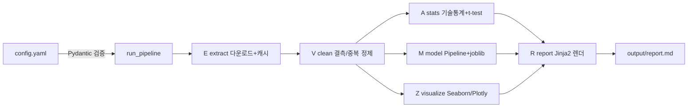

# SKALA-E2E-Analysis

Adult Census Income 데이터(1994 미국 인구조사, 32,561명)로 소득 그룹을 분석하고 예측하는 End2End 데이터 분석 파이프라인.

```
빠른 시작 (2줄)
  make setup      가상환경 + 의존성 + 패키지 설치
  make run        전체 파이프라인 실행 > output/report.md 생성
```

## 조종석 (Makefile)

| 명령 | 하는 일 |
|---|---|
| `make help` | 전체 타겟 목록 |
| `make setup` | .venv 생성, requirements.txt 설치, editable 설치 |
| `make run` | 파이프라인 완주: 다운로드 > 정제 > 통계 > 모델 > 차트 > 보고서 |
| `make test` | pytest + 커버리지 80% 게이트 |
| `make lint` | ruff check + format 확인 + mypy |
| `make format` | 코드 자동 정렬 |
| `make schedule` | 스케줄 실행기 1회 시연 (자동화 데모) |
| `make hooks` | pre-commit 훅 설치 (팀원 필수 1회) |
| `make clean` | 산출물/캐시 삭제 (재실행하면 전부 재생성) |

Windows 등 make가 없는 환경은 Makefile 안의 원본 명령을 그대로 실행하면 된다 (예: `.venv/bin/python -m e2e` 대신 `.venv\Scripts\python -m e2e`).

## 아키텍처



설계 원칙:

- **선언적 설정**: 데이터 URL, 컬럼, 타깃, 분할 파라미터 전부 `config.yaml` 한 곳에서 관리. `src/e2e/config.py`의 Pydantic 모델이 실행 전에 검증하므로 잘못된 설정은 파이프라인이 돌기 전에 즉시 오류로 드러난다. 데이터셋을 바꿔도 코드 수정이 필요 없다.
- **단계 분리**: extract > clean > stats > model > visualize > report가 독립 모듈. 실패 지점이 곧 책임 모듈이고, 단계별로 pytest가 붙어 있다.
- **멱등성**: 원천은 `data/raw` 캐시(있으면 재다운로드 생략), 산출물은 덮어쓰기. 언제 몇 번을 돌려도 같은 결과라서 schedule 자동 실행이 안전하다.
- **보고서 자동 생성**: `templates/report.md.j2`에 각 단계의 결과 딕셔너리를 주입해 렌더링. 수치를 손으로 옮겨 적지 않으므로 보고서와 코드가 어긋날 수 없다.

## config.yaml 레퍼런스

| 키 | 의미 | 기본값 |
|---|---|---|
| `project.seed` | 모든 난수(분할, 모델) 고정 시드 | 42 |
| `data.url` | 원천 데이터 출처 (UCI Adult) | UCI URL |
| `data.raw_path` | 다운로드 캐시 경로 | data/raw/adult.csv |
| `data.na_token` | 결측 토큰. 반드시 `"?"` (아래 주의 참고) | "?" |
| `analysis.target` | ML 타깃이자 검정 그룹 기준 | income |
| `analysis.hypothesis_feature` | 주 가설 변수 | hours-per-week |
| `analysis.alpha` | 유의수준 (검정 전 고정) | 0.05 |
| `model.test_size` | 평가 세트 비율 (stratify 적용) | 0.2 |
| `output.*` | 산출물 경로 (report, 차트, joblib) | output/ |

**주의: 결측 토큰 함정.** 슬라이드 예시의 `na_values=" ?"`는 `skipinitialspace=True`가 공백을 먼저 제거하기 때문에 매칭에 실패해 결측이 0건으로 보인다. `"?"`로 지정해야 실제 결측 4,262셀(workclass 1,836 / occupation 1,843 / native-country 583)이 잡힌다. 두 방식을 직접 실행해 검증했다.

## 분석 설계 요약

- **가설**: H0 = 소득 그룹(<=50K vs >50K) 간 주당 근로시간 평균은 같다. Welch t-test(사전 Levene 검정에서 등분산 기각) + Cohen's d 병행(대표본에서 p만 보면 미미한 차이도 유의해 보이는 함정 방어)
- **모델**: LogisticRegression 기준선. 지표는 accuracy + F1(클래스 76:24 불균형이라 F1 필수). MSE/R2는 회귀 지표라 사용하지 않음
- **데이터 출처**: [UCI Machine Learning Repository, Adult](https://archive.ics.uci.edu/dataset/2/adult). 원본은 저장소에 커밋하지 않고(`data/` gitignore) 실행 시 내려받아 캐시한다

## 협업 규칙

1. 이슈 생성 > `feature/#이슈번호-설명` 브랜치 > PR > CI 통과 + 리뷰 1명 > 머지
2. main 직접 푸시 금지 (브랜치 보호)
3. 커밋 전 `make lint && make test` 통과 확인 (`make hooks` 설치 시 자동)
4. CI는 3 OS x Python 3.11/3.13 매트릭스에서 ruff, mypy, pytest를 전부 실행

## 저장소 구조

```
config.yaml            모든 설정 (선언적 관리)
src/e2e/               파이프라인 패키지
  config.py            Pydantic 검증
  extract.py           E: 다운로드 + 캐시
  clean.py             V: 결측/중복 정제
  stats.py             A: 기술통계 + t-test + Cohen's d
  model.py             M: sklearn Pipeline + joblib
  visualize.py         Z: Seaborn 차트 (한글 폰트 처리)
  report.py            R: Jinja2 보고서 렌더
  pipeline.py          run_pipeline(config) 오케스트레이터
templates/report.md.j2 보고서 템플릿
scripts/schedule_runner.py  schedule 자동 실행기 (--once 시연 모드)
tests/                 단계별 단위 테스트 + E2E 스모크 (합성 데이터, 네트워크 불필요)
```
