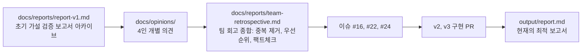
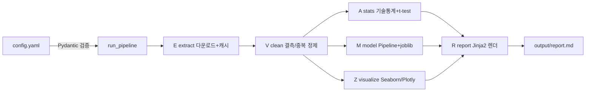

# SKALA-E2E-Analysis

Adult Census Income 데이터(1994 미국 인구조사, 32,561명)로 소득 그룹을 분석하고 예측하는 End2End 데이터 분석 파이프라인.

```
빠른 시작 (2줄)
  make setup      가상환경 + 의존성 + 패키지 설치
  make run        전체 파이프라인 실행 > output/report.md 생성
```

## 문서 체계: 보고서가 진화해 온 흐름

이 저장소의 문서들은 하나의 개선 루프를 이룬다. 읽는 순서 그대로가 프로젝트의 스토리다.



| 문서 | 역할 |
|---|---|
| `output/report.md` | 실행할 때마다 재생성되는 **현재의 최종 분석 보고서**. 검정 7종, 평가 3층, 차트 7종의 결과가 담긴다 |
| `docs/reports/report-v1.md` | **초기 가설 검증 시점의 보고서 아카이브**. 실행 캡처와 수치 크로스체크까지 박제되어 있어, 현재 보고서와의 차이가 곧 개선의 증거다 |
| `docs/opinions/*.md` | 팀원 4명이 v1 보고서와 프로젝트를 검토하고 남긴 **개별 의견**. 수치(자동 보고서)와 해석(사람)을 분리하는 공간이며, 코드와 같은 절차(PR)로 작성한다 |
| `docs/reports/team-retrospective.md` | 개별 의견을 팀이 함께 검토해 **중복을 제거하고 우선순위를 정한 종합본**. 전원 합의 4건, 로드맵 6건, 고유 지적 7건, 그리고 회고 속 추정치의 팩트체크가 담겨 있다 |

핵심은 마지막 연결이다: 회고가 백로그로 끝나지 않고 이슈(#16, #22, #24)로 전환되어
**제안 전건이 코드로 구현**됐고, 그 결과가 지금의 `output/report.md`다. 예를 들어
회고 시점의 추정치 "초과근무 비율 약 25% vs 45%"는 구현 후 실측 "24.1% vs 49.8%
(카이제곱 1760.4, p < 0.001)"로 확정됐다.

## 조종석 (Makefile)

| 명령 | 하는 일 |
|---|---|
| `make help` | 전체 타겟 목록 |
| `make setup` | .venv 생성, requirements.txt 설치, editable 설치 |
| `make run` | 파이프라인 완주: 다운로드 > 정제 > 통계 > 모델 > 차트 > 보고서 |
| `make test` | pytest + 커버리지 80% 게이트 |
| `make lint` | ruff check + format 확인 + mypy |
| `make format` | 코드 자동 정렬 |
| `make schedule` | 스케줄 실행기 1회 시연 (자동화 데모) |
| `make hooks` | pre-commit 훅 설치 (팀원 필수 1회) |
| `make clean` | 산출물/캐시 삭제 (재실행하면 전부 재생성) |

Windows 등 make가 없는 환경은 Makefile 안의 원본 명령을 그대로 실행하면 된다 (예: `.venv/bin/python -m e2e` 대신 `.venv\Scripts\python -m e2e`).

## 아키텍처



설계 원칙:

- **선언적 설정**: 데이터 URL, 컬럼, 타깃, 분할 파라미터 전부 `config.yaml` 한 곳에서 관리. `src/e2e/config.py`의 Pydantic 모델이 실행 전에 검증하므로 잘못된 설정은 파이프라인이 돌기 전에 즉시 오류로 드러난다. 데이터셋을 바꿔도 코드 수정이 필요 없다.
- **단계 분리**: extract > clean > stats > model > visualize > report가 독립 모듈. 실패 지점이 곧 책임 모듈이고, 단계별로 pytest가 붙어 있다.
- **멱등성**: 원천은 `data/raw` 캐시(있으면 재다운로드 생략), 산출물은 덮어쓰기. 언제 몇 번을 돌려도 같은 결과라서 schedule 자동 실행이 안전하다.
- **보고서 자동 생성**: `templates/report.md.j2`에 각 단계의 결과 딕셔너리를 주입해 렌더링. 수치를 손으로 옮겨 적지 않으므로 보고서와 코드가 어긋날 수 없다.

## config.yaml 레퍼런스

| 키 | 의미 | 기본값 |
|---|---|---|
| `project.seed` | 모든 난수(분할, 모델) 고정 시드 | 42 |
| `data.url` | 원천 데이터 출처 (UCI Adult) | UCI URL |
| `data.raw_path` | 다운로드 캐시 경로 | data/raw/adult.csv |
| `data.na_token` | 결측 토큰. 반드시 `"?"` (아래 주의 참고) | "?" |
| `analysis.target` | ML 타깃이자 검정 그룹 기준 | income |
| `analysis.hypothesis_feature` | 주 가설 변수 | hours-per-week |
| `analysis.alpha` | 유의수준 (검정 전 고정) | 0.05 |
| `model.test_size` | 평가 세트 비율 (stratify 적용) | 0.2 |
| `output.*` | 산출물 경로 (report, 차트, joblib) | output/ |

**주의: 결측 토큰 함정.** 슬라이드 예시의 `na_values=" ?"`는 `skipinitialspace=True`가 공백을 먼저 제거하기 때문에 매칭에 실패해 결측이 0건으로 보인다. `"?"`로 지정해야 실제 결측 4,262셀(workclass 1,836 / occupation 1,843 / native-country 583)이 잡힌다. 두 방식을 직접 실행해 검증했다.

## 분석 설계 요약

- **가설**: H0 = 소득 그룹(<=50K vs >50K) 간 주당 근로시간 평균은 같다. Welch t-test(사전 Levene 검정에서 등분산 기각) + Cohen's d 병행(대표본에서 p만 보면 미미한 차이도 유의해 보이는 함정 방어)
- **모델**: LogisticRegression 기준선. 지표는 accuracy + F1(클래스 76:24 불균형이라 F1 필수). MSE/R2는 회귀 지표라 사용하지 않음
- **데이터 출처**: [UCI Machine Learning Repository, Adult](https://archive.ics.uci.edu/dataset/2/adult). 원본은 저장소에 커밋하지 않고(`data/` gitignore) 실행 시 내려받아 캐시한다

## 협업 규칙

1. 이슈 생성 > `feature/#이슈번호-설명` 브랜치 > PR > CI 통과 + 리뷰 1명 > 머지
2. main 직접 푸시 금지 (브랜치 보호)
3. 커밋 전 `make lint && make test` 통과 확인 (`make hooks` 설치 시 자동)
4. CI는 3 OS x Python 3.11/3.13 매트릭스에서 ruff, mypy, pytest를 전부 실행

## 저장소 구조

```
config.yaml            모든 설정 (선언적 관리)
src/e2e/               파이프라인 패키지
  config.py            Pydantic 검증
  extract.py           E: 다운로드 + 캐시
  clean.py             V: Pandas vs Polars 로딩 비교 + 결측/중복 정제
  stats.py             A: 기술통계 + 상관 + 검정 3종(Levene/Welch/Mann-Whitney) + Cohen's d
  model.py             M: sklearn Pipeline + 모델 비교(LogReg vs RF) + joblib
  visualize.py         Z: Seaborn PNG 3종 + Plotly HTML (한글 폰트 처리)
  report.py            R: Jinja2 보고서 렌더
  pipeline.py          run_pipeline(config) 오케스트레이터
templates/report.md.j2 보고서 템플릿
scripts/schedule_runner.py  schedule 자동 실행기 (--once 시연 모드)
tests/                 단계별 단위 테스트 + E2E 스모크 (합성 데이터, 네트워크 불필요)
docs/opinions/         팀원 개별 의견 (수치는 보고서가, 해석은 사람이)
docs/reports/          report-v1 아카이브, 팀 회고 종합 (문서 체계 절 참조)
```

## 트러블슈팅 기록 (개발 중 실제로 겪은 문제들)

| 문제 | 원인 | 해결 |
|---|---|---|
| 결측이 0건으로 보임 | `na_values=" ?"`와 `skipinitialspace=True` 조합: 공백 제거가 먼저 실행되어 `" ?"`가 영원히 매칭 안 됨 | `na_values="?"`로 변경, 실측 4,262셀 확인. 두 방식을 나란히 실행해 검증 |
| Polars 로딩 시 수치 컬럼이 문자열로 추론 | 원본 값 앞 공백(`" 39"`) 때문에 스키마 추론 실패 가능 | `infer_schema=False`로 전부 문자열로 읽고 strip 후 수치 컬럼만 명시적 캐스팅 |
| 멱등성 테스트 간헐 실패 | 로딩 시간 측정값이 실행마다 달라짐 | 멱등성 비교에서 시간 측정 키 제외 (정제 결과와 p-value만 비교) |
| 상관행렬 대각선이 NaN | 분산 0인 컬럼(테스트 데이터의 capital-gain)은 상관계수가 0/0으로 정의 불가 | 분산 0 컬럼을 상관 대상에서 제외 (통계적으로도 올바른 처리) |
| CI(리눅스)에서 한글 폰트 없음 | GitHub Actions 러너에 한글 폰트 미설치 | 폰트 미탐지 시 경고만 남기고 진행하는 우아한 저하 설계 |
| 차트가 CI에서 저장 실패 가능 | 디스플레이 없는 headless 환경 | `matplotlib.use("Agg")`를 pyplot import 전에 고정 |
| Pandas와 Polars 행수 불일치 (32,561 vs 32,562) | 원본 파일이 빈 줄로 끝남: Pandas는 skip_blank_lines 기본으로 건너뛰지만 Polars는 전부 null인 행으로 파싱 | 전 컬럼 null 행 필터링으로 Pandas 동작에 정렬. 합성 테스트는 통과했는데 실데이터 로그로만 드러난 사례라 픽스처에도 빈 줄을 재현해 회귀 방지 |
