# E2E Analysis: 데이터 수집, 정제, 분석, 보고서 자동화

명령 한 줄(`make run`)로 원천 데이터를 내려받고, 정제하고, 통계 검정과 분류 모델을 돌린 뒤, 차트와 분석 보고서까지 만들어 내는 파이프라인입니다.
<br>
<br>
1994년 미국 인구조사(UCI Adult, 32,561명)로 "고소득 그룹은 더 오래 일하는가"를 검증했고, 보고서의 모든 숫자는 사람이 옮겨 적지 않고 파이프라인이 직접 렌더링합니다.
<br>
<br>
왜 이렇게 나눴는지와 그 대가는 아래 ([🏗️ 구조](#️-구조), [⚖️ 트레이드오프](#️-트레이드오프))에 정리했습니다.

| 파이프라인 실행 (3.0초) | 자동 생성 보고서 | 분석 차트 | 인터랙티브 차트 |
|:-:|:-:|:-:|:-:|
| 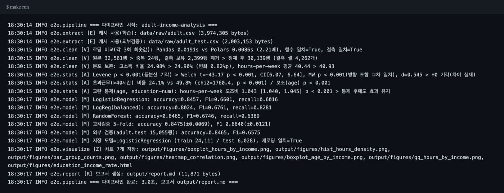 | 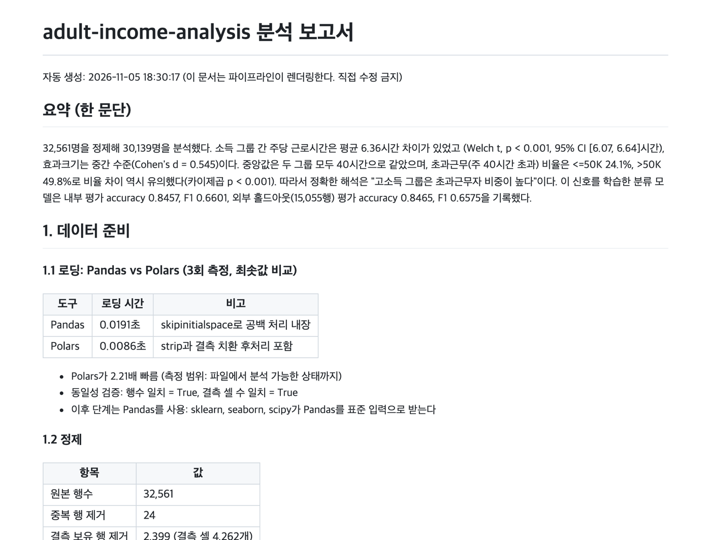 | 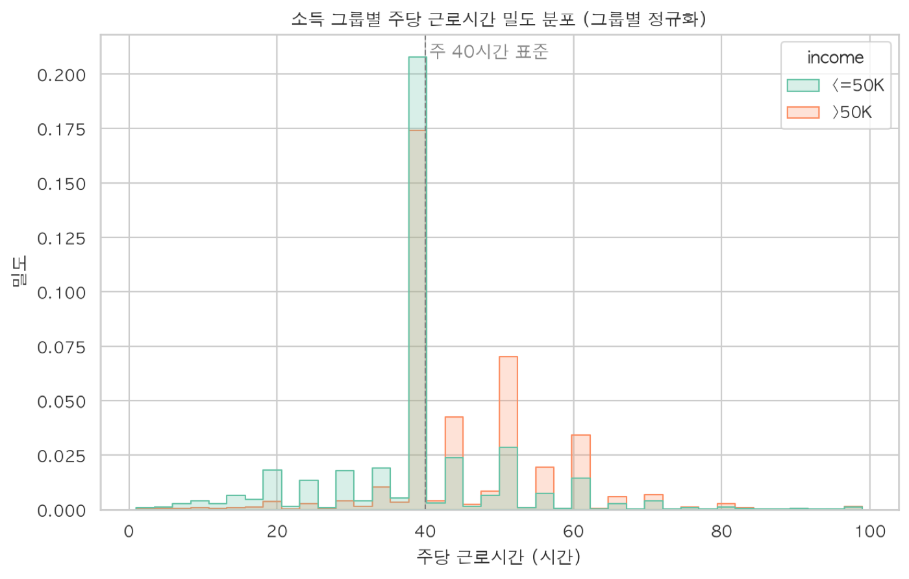 | 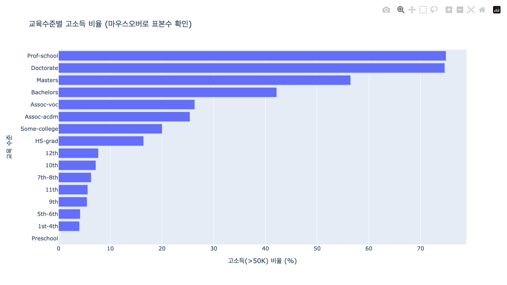 |
| E, V, A, M, Z, R 단계가 로그로 자기 검증값을 남깁니다 | `output/report.md` 를 Jinja2 로 렌더링 | Seaborn PNG 6종 | Plotly HTML (교육수준별 고소득 비율) |

## 📚 목차
- [💻 실행 방법](#-실행-방법)
- [📚 구현 스펙](#-구현-스펙)
- [🎯 문제 정의](#-문제-정의)
- [🏗️ 구조](#️-구조)
- [📱 주요 기능](#-주요-기능)
- [🧨 트러블슈팅](#-트러블슈팅)
- [💭 이유 있는 코드](#-이유-있는-코드)
- [⚖️ 트레이드오프](#️-트레이드오프)
- [📅 일정 관리](#-일정-관리)
- [👥 팀 구성과 내 역할](#-팀-구성과-내-역할)

### 📖 Wiki
[Home](docs/wiki/Home.md) | [Architecture](docs/wiki/Architecture.md) | [Tradeoffs](docs/wiki/Tradeoffs.md) | [Troubleshooting](docs/wiki/Troubleshooting.md) | [Evaluation](docs/wiki/Evaluation.md) | [Schedule](docs/wiki/Schedule.md)

<br>
<br>

## 💻 실행 방법

Python 3.11 이상, API 키는 필요 없습니다.

```bash
make setup      # .venv 생성 + requirements.txt 설치 + editable 설치
make run        # 수집 > 정제 > 분석 > 모델 > 차트 > 보고서 (output/report.md)
make test       # pytest 38건 + 커버리지 80% 게이트
make lint       # ruff check, ruff format --check, mypy
make schedule   # 스케줄 실행기 1회 시연 (매일 08:00 자동 실행의 --once 모드)
make clean      # output, data/raw, 캐시 삭제 (다시 돌리면 전부 재생성)
```

첫 실행만 UCI 저장소에서 원천 파일 2개(약 4MB, 2MB)를 내려받고, 이후로는 `data/raw` 캐시를 씁니다.
make 가 없는 환경은 Makefile 안의 명령을 그대로 실행하면 됩니다 (예: `.venv\Scripts\python -m e2e`).

<details>
<summary>config.yaml 주요 키</summary>

| 키 | 의미 | 기본값 |
|---|---|---|
| `project.seed` | 분할과 모델의 난수 고정 | 42 |
| `data.url`, `data.test_url` | 학습 원천, 외부 검증 홀드아웃 | UCI adult.data, adult.test |
| `data.na_token` | 결측 토큰. 반드시 `"?"` ([트러블슈팅 1](#1-결측이-0건으로-보였다-결측-토큰)) | "?" |
| `analysis.target` | 분류 타깃이자 검정 그룹 기준 | income |
| `analysis.hypothesis_feature` | 주 가설 변수 | hours-per-week |
| `analysis.alpha` | 유의수준 (검정 전에 고정) | 0.05 |
| `model.test_size` | 평가 세트 비율 (stratify) | 0.2 |
| `output.*` | 보고서, 차트, joblib 경로 | output/ |

데이터셋을 바꿀 때는 코드가 아니라 이 파일만 고칩니다. 실행 전에 Pydantic 이 검증하므로 오타나 범위 밖 값은 파이프라인이 돌기 전에 오류로 드러납니다.
</details>

[⬆️  목차로](#-목차)

<br>
<br>

## 📚 구현 스펙

| 항목 | 내용 |
|---|---|
| Language | Python 3.11 / 3.13 |
| 수집 | urllib (재시도 3회, 불완전 파일 삭제), 로컬 파일 캐시 |
| 정제 | Pandas 3, Polars 1 (로딩 속도와 결과 동일성 비교) |
| 분석 | SciPy (Levene, Welch t, Mann-Whitney U, 카이제곱), statsmodels (교란변수 통제 로지스틱 회귀) |
| 모델 | scikit-learn Pipeline (ColumnTransformer + LogisticRegression / RandomForest), joblib |
| 시각화 | Matplotlib, Seaborn (PNG 6종), Plotly (인터랙티브 HTML) |
| 보고서 | Jinja2 템플릿 (`templates/report.md.j2`) |
| 설정 | config.yaml + Pydantic v2 검증 |
| 자동화 | Makefile, schedule (매일 08:00), pre-commit |
| 테스트 | pytest 38건, 커버리지 95.3% (게이트 80%), 네트워크 없이 합성 데이터로 실행 |
| CI | GitHub Actions: ubuntu, macos, windows x Python 3.11, 3.13 매트릭스 (ruff, mypy, pytest) |

[⬆️  목차로](#-목차)

<br>
<br>

## 🎯 문제 정의

"고소득자는 더 오래 일한다"는 문장을 숫자로 확인하려면, 실제로는 네 가지가 동시에 맞아야 한다고 봤습니다.

1. **데이터가 정말 깨끗한가**: 결측을 0건으로 잘못 읽거나, 도구마다 행 수가 다르면 그 뒤의 모든 결론이 무너집니다
2. **검정이 결론 문장과 맞는가**: 평균 차이가 유의해도, 중앙값이 같다면 "더 오래 일한다"는 표현은 틀릴 수 있습니다
3. **모델 성능이 운이 아닌가**: 한 번의 8:2 분할 점수는 분할에 따라 흔들립니다
4. **보고서가 코드와 같은 숫자를 말하는가**: 손으로 옮긴 보고서는 코드가 바뀌는 순간 어긋납니다

그래서 파이프라인을 단계별 모듈로 나누고, 각 단계가 **결과와 함께 자기 검증값**을 반환하게 했습니다.

```
  수집 (extract)  >  정제 (clean)  >  분석 (stats, model, visualize)  >  보고서 (report)
  캐시/재시도        행수 일치,         Levene > Welch > CI > MW U > d       Jinja2 로
                     결측 일치,         카이제곱, 교란 통제                  dict 를 그대로 렌더
                     분포 보존 검증     5-fold CV, 외부 홀드아웃
```

이 설계 덕에 검증값이 로그에 그대로 찍혔고, 합성 데이터 테스트는 통과했는데 실데이터에서만 `행수 일치=False` 가 뜬 버그를 잡을 수 있었습니다 ([트러블슈팅 2](#2-pandas-와-polars-의-행-수가-1행-달랐다-파일-끝-빈-줄-11)).

<br>

---

### 결론 문장을 바꾼 과정

처음 보고서(v1)는 "고소득 그룹이 평균 6.36시간 더 일한다"에서 멈췄습니다.
<br>
그런데 기술통계를 다시 보니 **중앙값은 두 그룹 모두 40시간**이었습니다. 차이는 가운데가 아니라 40시간 오른쪽 꼬리에서 오고 있었습니다.

| 소득 | n | 평균 | Q1 | 중앙값 | Q3 |
|---|---|---|---|---|---|
| <=50K | 22,633 | 39.35 | 38 | 40 | 40 |
| >50K | 7,506 | 45.71 | 40 | 40 | 50 |

해석을 "고소득 그룹은 **초과근무자 비중이 높다**"로 고치고, 고친 문장을 다시 검정했습니다.
<br>
주 40시간 초과 여부로 이진화한 뒤 카이제곱 독립성 검정을 돌려 **24.1% vs 49.8% (카이제곱 1760.4, p < 0.001)** 로 확정했습니다.
<br>
`평균 검정 > 중앙값 동일 발견 > 해석 수정 > 수정된 해석의 재검정` 순서로 논증이 닫히도록 코드도 그 순서로 짰습니다.

<details>
<summary>초과근무 비율 검정 (stats.py)</summary>

```python
OVERTIME_THRESHOLD = 40  # 초과근무 기준(주 40시간 표준 근무제)

def _overtime_test(df, target, feature, groups):
    overtime = df[feature] > OVERTIME_THRESHOLD           # 이진화
    table = pd.crosstab(df[target], overtime)
    chi2, p, _, _ = sps.chi2_contingency(table)           # 비율 차이를 직접 검정
    ...
```
</details>

[⬆️  목차로](#-목차)

<br>
<br>

## 🏗️ 구조

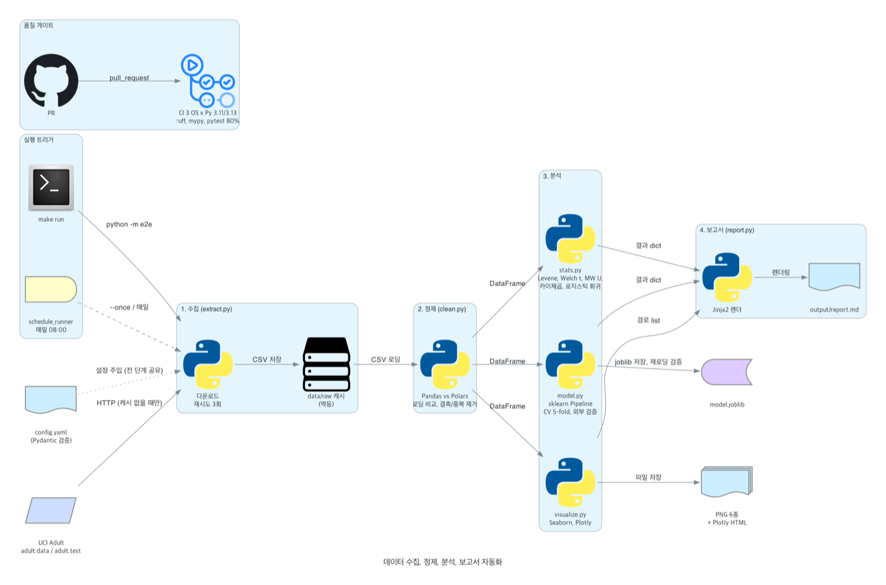

> 그림 생성 코드: [`docs/diagrams/architecture.py`](docs/diagrams/architecture.py)

| 단계 | 모듈 | 입력 | 출력 | 자기 검증값 |
|---|---|---|---|---|
| 수집 | `extract.py` | config 의 URL | `data/raw/*.csv` | 캐시 크기, 재시도 로그 |
| 정제 | `clean.py` | 원천 CSV | 정제된 DataFrame, 메타 dict | Pandas, Polars 행수 일치, 결측 일치, 정제 전후 분포 보존 |
| 분석 | `stats.py` | DataFrame | 검정 결과 dict | Levene 결과로 Welch 선택 근거, MW U 방향 일치 |
| 모델 | `model.py` | DataFrame | 지표 dict, `model.joblib` | 5-fold 표준편차, 외부 홀드아웃 점수, joblib 재로딩 예측 일치 |
| 시각화 | `visualize.py` | DataFrame | PNG 6종, HTML 1종 | 저장 경로 list |
| 보고서 | `report.py` | 위 dict 전부 | `output/report.md` | 템플릿 렌더 (수치 수기 입력 0) |

`pipeline.py` 의 `run_pipeline(config)` 는 로직 없이 단계를 순서대로 호출하고 결과 dict 를 모으기만 합니다. 실패 지점이 곧 책임 모듈입니다.

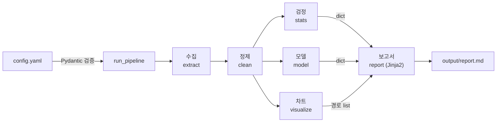

<br>

---

### 멱등성: 언제 몇 번을 돌려도 같은 결과

원천은 `data/raw` 캐시(있으면 다운로드 생략), 산출물은 덮어쓰기, 난수는 `seed: 42` 고정입니다.
<br>
그래서 `schedule_runner.py` 가 매일 08:00 에 같은 파이프라인을 다시 돌려도 안전하고, 실패한 날은 다음 주기에 그대로 재시도하면 됩니다.
<br>
스케줄 잡은 예외를 잡아 로그만 남기고 루프를 살리되, 사람이 직접 돌리는 `--once` 는 실패를 종료 코드 1로 알립니다.

[⬆️  목차로](#-목차)

<br>
<br>

## 📱 주요 기능

아래 화면은 이 저장소를 로컬에서 `make run` 으로 실제 실행해 만든 산출물입니다.

| 정제 결과와 로딩 비교 | 검정 절차 표 | 모델 평가 3층 |
|:-:|:-:|:-:|
|  | 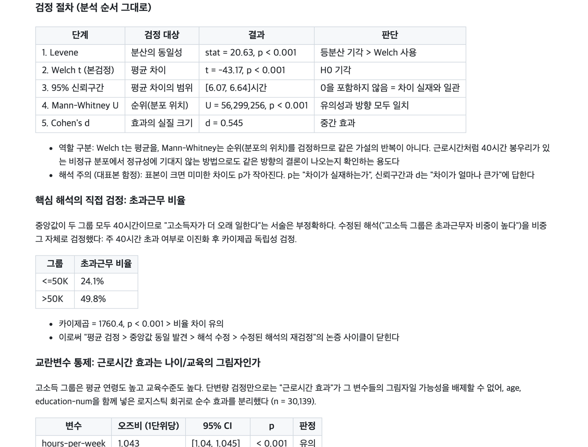 | 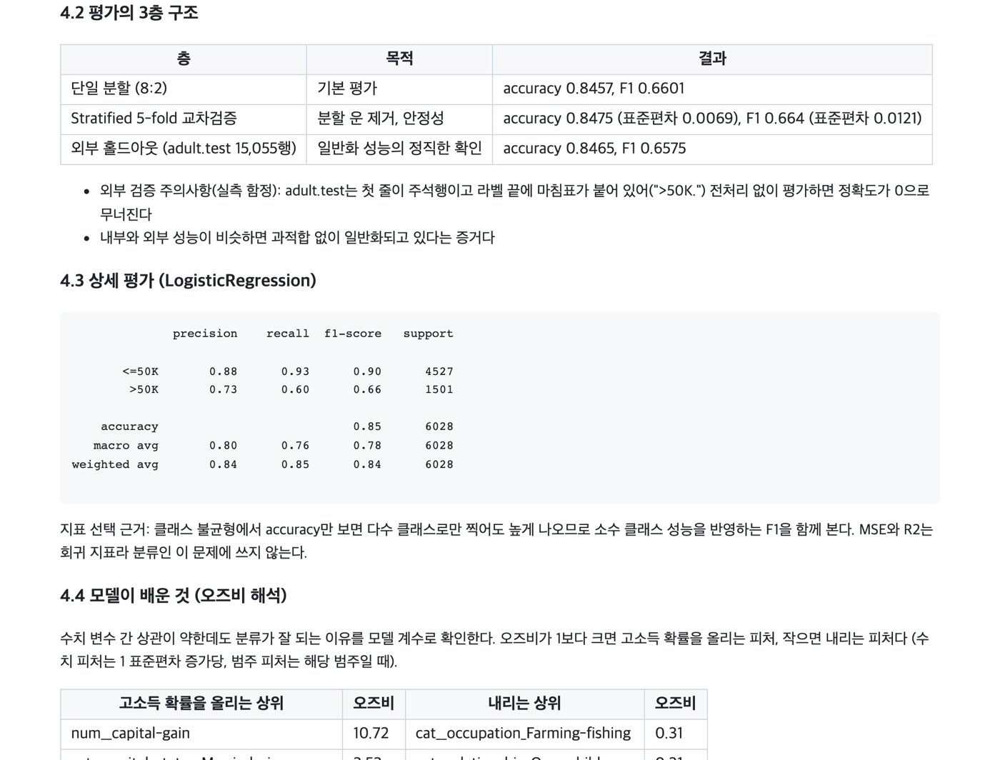 |
| 32,561행 > 30,139행. Polars 가 2.21배 빠르고 결과는 같음 | Levene > Welch t > 95% CI > MW U > Cohen's d | 단일 분할, 5-fold, 외부 홀드아웃 15,055행 |

| 근로시간 분포 | 밀도 히스토그램 | 상관 히트맵 |
|:-:|:-:|:-:|
| 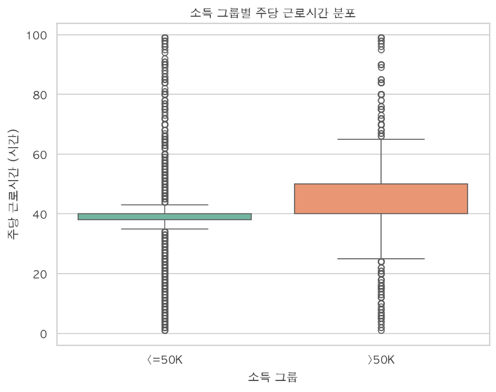 |  | 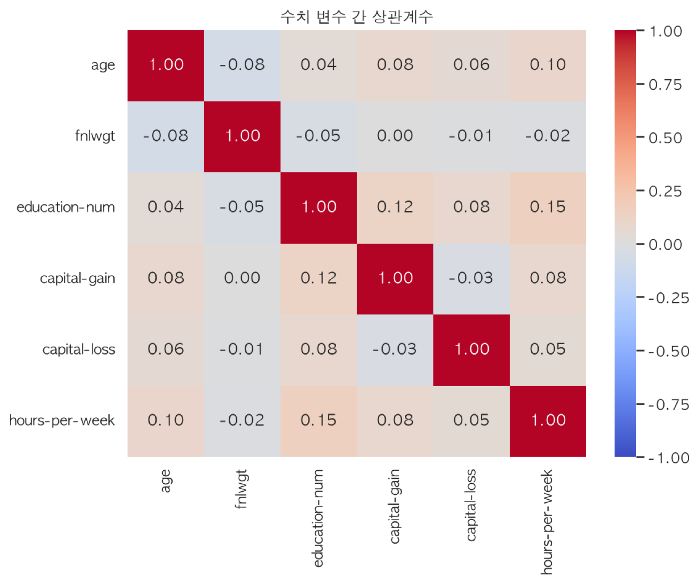 |
| 고소득 그룹의 Q3 가 50시간 | 두 그룹 모두 40시간 봉우리, 차이는 오른쪽 꼬리 | 수치 변수 상관은 최대 0.15. 신호는 범주 변수에 있음 |

| Q-Q 플롯 | 그룹 표본수 | 연령 분포 (보조가설) |
|:-:|:-:|:-:|
| 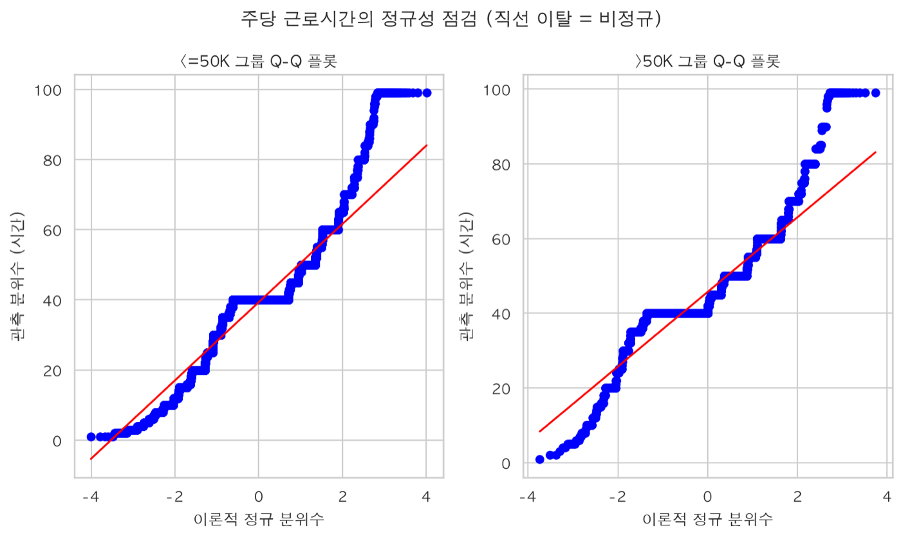 | 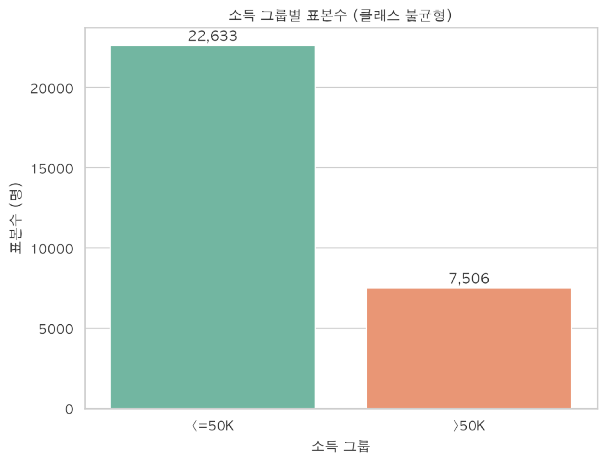 | 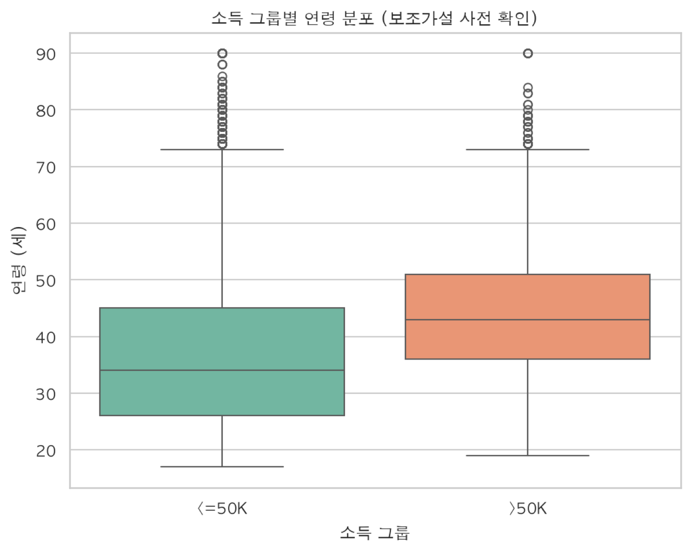 |
| 계단형, 꼬리 이탈 = 비정규. 비모수 검정을 함께 쓰는 근거 | 76:24 불균형. F1 을 함께 보는 근거 | 보조가설도 시각화 후 검정 순서를 따름 |

### 핵심 결과

| 질문 | 결과 |
|---|---|
| 평균 근로시간 차이 | 6.36시간, Welch t = -43.17, p < 0.001, 95% CI [6.07, 6.64] |
| 차이의 실질 크기 | Cohen's d = 0.545 (중간 효과) |
| 초과근무 비율 | 24.1% vs 49.8%, 카이제곱 1760.4, p < 0.001 |
| 나이, 교육을 통제해도 남는가 | 근로시간 오즈비 1.043 [1.040, 1.045], p < 0.001 (시간당 고소득 오즈 4.3% 증가) |
| 분류 성능 (LogisticRegression) | 내부 accuracy 0.8457 / F1 0.6601, 5-fold 0.8475 (±0.0069), 외부 0.8465 / F1 0.6575 |

> 출처: `make run` 로그와 `output/report.md` (2026-11-05 로컬 재실행, 원 커밋 시점 수치와 동일)

[⬆️  목차로](#-목차)

<br>
<br>

## 🧨 트러블슈팅

### 1. 결측이 0건으로 보였다 (결측 토큰)

흔히 쓰이는 예시 코드 `na_values=" ?"` 로 읽으니 결측이 0건으로 나왔습니다.
<br>
`skipinitialspace=True` 가 값 앞 공백을 **먼저** 지우기 때문에, `" ?"` 는 영원히 매칭되지 않습니다.
<br>
두 방식을 나란히 실행해 확인한 뒤 토큰을 `"?"` 로 바꾸자 실제 결측 **4,262셀** (workclass 1,836 / occupation 1,843 / native-country 583) 이 잡혔습니다.

| | Before (`" ?"`) | After (`"?"`) |
|---|---|---|
| 결측 셀 | 0 | 4,262 |
| 정제 후 행 | 32,537 (중복만 제거) | 30,139 |

<details>
<summary>해결 (config.yaml, clean.py)</summary>

```yaml
na_token: "?"   # skipinitialspace 가 공백을 먼저 지우므로 " ?" 는 매칭 실패
```
```python
pd.read_csv(path, header=None, names=cols,
            na_values=config.data.na_token, skipinitialspace=True)
```
</details>

<br>

---

### 2. Pandas 와 Polars 의 행 수가 1행 달랐다 (파일 끝 빈 줄) [#11](https://github.com/YooGyeongMo/SKALA-E2E-Analysis/issues/11)

합성 데이터 테스트는 전부 통과했는데, 실데이터로 `make run` 을 돌리자 로그에 `행수 일치=False` 가 찍혔습니다 (Pandas 32,561 vs Polars 32,562, 결측 15셀 차이).
<br>
원본 파일이 빈 줄로 끝나는데, Pandas 는 `skip_blank_lines=True` 가 기본이라 건너뛰고 Polars 는 **전 컬럼이 null 인 행 1개**로 읽고 있었습니다.
<br>
전 컬럼 null 행을 걸러 Pandas 동작에 맞추고, 테스트 픽스처에도 파일 끝 빈 줄을 재현해 회귀를 막았습니다. ([PR #12](https://github.com/YooGyeongMo/SKALA-E2E-Analysis/pull/12))

<details>
<summary>해결 (clean.py)</summary>

```python
# 파일 끝 빈 줄: Pandas 는 건너뛰지만 Polars 는 전부 null 인 행으로 파싱한다
df = df.filter(~pl.all_horizontal(pl.all().is_null()))
```
</details>

검증값을 계산만 하고 숨겼다면 이 버그는 보고서에 그대로 묻혔을 겁니다. 그래서 모든 단계가 검증값을 로그와 보고서 양쪽에 남기게 했습니다.

<br>

---

### 3. 외부 검증 정확도가 0.0000 이었다 (홀드아웃 파일 형식) [#16](https://github.com/YooGyeongMo/SKALA-E2E-Analysis/issues/16)

UCI 가 따로 주는 `adult.test` 로 일반화 성능을 보려 했는데, 그대로 넣으면 두 가지가 어긋납니다.
<br>
첫 줄이 주석행(`|1x3 Cross validator`)이고, 라벨 끝에 마침표가 붙어 있습니다(`">50K."`). 학습 라벨 `">50K"` 와 매칭되지 않아 모든 예측이 오답 처리됩니다.
<br>
`skiprows=1` 과 `str.rstrip(".")` 로 맞췄고, 마침표를 일부러 남긴 반증 실험에서 accuracy 0.0000 이 나오는 것까지 확인했습니다.

| | 전처리 없음 | 전처리 후 |
|---|---|---|
| 외부 accuracy | 0.0000 | 0.8465 (15,055행) |

<details>
<summary>해결 (model.py)</summary>

```python
df = pd.read_csv(path, ..., skiprows=1)        # 첫 줄 주석행
df[target] = df[target].str.rstrip(".")         # ">50K." > ">50K"
```
</details>

<br>

---

### 4. CI 에서만 깨질 수 있는 지점들 (헤드리스, 폰트, 측정 시간)

| 문제 | 원인 | 해결 |
|---|---|---|
| 리눅스 러너에서 차트 저장 실패 가능 | 디스플레이 없는 headless 환경 | pyplot import 전에 `matplotlib.use("Agg")` 고정 |
| 리눅스 러너에 한글 폰트 없음 | Actions 러너 기본 이미지 | AppleGothic, Malgun Gothic, NanumGothic 순으로 찾고, 없으면 경고만 남기고 진행 |
| 멱등성 테스트가 간헐 실패 | 로딩 시간 측정값이 실행마다 다름 | 비교 대상에서 시간 키를 빼고 정제 결과와 p-value 만 비교 |
| 상관행렬 대각선 NaN | 분산 0 인 컬럼은 상관계수가 0/0 | 분산 0 컬럼을 상관 대상에서 제외 |

[⬆️  목차로](#-목차)

<br>
<br>

## 💭 이유 있는 코드

### 보고서는 사람이 쓰지 않는다

각 단계가 반환한 dict 를 `templates/report.md.j2` 에 그대로 주입해 렌더링합니다.
<br>
숫자를 옮겨 적는 사람이 없으니 보고서와 코드가 어긋날 수 없고, `make run` 한 번이면 항상 최신입니다.
<br>
같은 이유로 소스 주석에도 실측 수치를 쓰지 않았습니다. 처음엔 머리말에 `39.35` 같은 값을 적어 뒀는데, 분석 조건이 바뀌면 주석만 틀린 채 남는다는 팀원 리뷰를 받고 설계 의도만 남기도록 고쳤습니다.

<details>
<summary>오케스트레이터 (pipeline.py)</summary>

```python
def run_pipeline(config: AppConfig) -> dict[str, Any]:
    extract(config)
    df, clean_meta = load_and_clean(config)
    stats_result = analyze(config, df)
    model_result = train_and_save(config, df)
    figures = visualize(config, df)
    report_path = render_report(config, {
        "clean": clean_meta, "stats": stats_result,
        "model": model_result, "figures": figures,
    })
```
</details>

<br>

---

### 검정은 분석 순서 그대로 코드로

| 순서 | 검정 | 왜 필요한가 |
|---|---|---|
| 1 | Levene | 등분산이 기각되면 Student t 대신 Welch t 를 쓴다. 선택의 근거를 결과로 남긴다 |
| 2 | Welch t + 95% CI | 평균 차이와 그 불확실성 |
| 3 | Mann-Whitney U | 평균이 아니라 순위를 검정. 40시간 봉우리가 있는 비정규 분포에서 정규성 없이도 같은 방향인지 확인 |
| 4 | Cohen's d | n = 30,139 에서는 미미한 차이도 p < 0.001. p 는 "있는가", d 는 "얼마나 큰가" |
| 5 | 카이제곱 | 결론 문장("비중이 높다")을 비중 자체로 검정 |
| 6 | 로지스틱 회귀 (age, education-num 통제) | 근로시간 효과가 나이, 교육의 그림자가 아닌지 |

보조가설(연령)은 다중비교 보정을 하지 않았기 때문에 보고서에 "탐색적 보강"이라고 한계를 함께 적습니다.

<br>

---

### Polars 가 2.21배 빠른데도 Pandas 로 흘려보낸다

로딩만 보면 Polars 가 빠릅니다 (0.0086초 vs 0.0191초, 각 3회 최솟값).
<br>
측정 범위도 "파일에서 분석 가능한 상태까지"로 맞췄습니다. Pandas 는 공백 제거가 옵션으로 내장이지만 Polars 는 `strip_chars` 후처리가 필요해서, 순수 파싱만 재면 Polars 쪽으로 왜곡되기 때문입니다.
<br>
그래도 이후 단계는 Pandas DataFrame 을 씁니다. scikit-learn, Seaborn, SciPy 가 Pandas 를 표준 입력으로 받아 변환 비용 없이 흐르고, 3만 행에서 0.01초 차이는 전체 3.0초 실행에서 의미가 없습니다. 비교는 "속도"보다 **두 도구가 같은 결과를 내는지(행수, 결측 일치)** 를 보는 검증 장치로 남겼습니다.

[⬆️  목차로](#-목차)

<br>
<br>

## ⚖️ 트레이드오프

| 결정 | 대안 | 고른 이유 | 비용 | 다시 볼 조건 |
|---|---|---|---|---|
| 결측 행 제거 (`dropna`) | 최빈값 대체, 결측 범주화 | 결측이 3개 범주 컬럼에 몰려 있어 대체하면 특정 범주가 부풀어 오름. 그룹 비교가 목적 | 2,399행(7.4%) 손실. 제거 전후 고소득 비율 24.08% > 24.90% (0.82%p) 로 왜곡이 작음을 확인 | 예측 서비스로 바뀌어 결측 행도 예측해야 할 때 |
| 저장 모델 = LogisticRegression | RandomForest (F1 0.6746) | 계수를 오즈비로 읽을 수 있어 "모델이 배운 것"을 설명 가능. F1 차이 0.0145 | 소폭 낮은 F1 | 해석보다 성능이 중요한 배포 상황 |
| class_weight 기본값 유지 | `balanced` (recall 0.60 > 0.83) | balanced 는 개선이 아니라 "어느 쪽으로 틀릴지"의 선택. accuracy 0.85 > 0.80 | 고소득자를 40% 놓침 | 고소득자를 놓치면 안 되는 업무 (보고서에 두 결과 모두 표기) |
| 설정을 config.yaml + Pydantic 으로 분리 | 코드 상수 | 데이터셋, 유의수준, 분할 비율을 코드 수정 없이 교체. 잘못된 값은 실행 전 실패 | 스키마 클래스 유지 비용 | 설정이 환경별로 갈라질 때 (그때 env 오버라이드 추가) |
| 로컬 schedule 실행기 | GitHub Actions cron | 데이터와 산출물이 로컬에 있고, 멱등이라 단순 루프로 충분 | 머신이 꺼지면 실행 안 됨 | 무인 운영과 보고서 자동 커밋이 필요할 때 |
| CI 3 OS x 2 Python 매트릭스 | ubuntu 한 개 | 팀원 4명이 각자 로컬에서 돌리므로 OS 별 폰트, 경로 차이를 PR 단계에서 잡음 | 실행 1회 약 3분 | 팀이 단일 OS 로 통일될 때 |

더 많은 결정 기록은 [Tradeoffs](docs/wiki/Tradeoffs.md) 에 있습니다.

[⬆️  목차로](#-목차)

<br>
<br>

## 📅 일정 관리

하루(2026-08-07, KST) 안에 이슈 11개, PR 19개로 쪼개 진행했습니다. 모든 작업은 `이슈 > feature/#번호-설명 브랜치 > PR > CI 통과 > 머지` 를 거쳤고, main 직접 푸시는 막아 뒀습니다.

```mermaid
gantt
    title 2026-08-07 작업 타임라인 (KST)
    dateFormat HH:mm
    axisFormat %H:%M
    section 뼈대
    #1 config 파이프라인, 품질 게이트, CI      :done, 16:01, 21m
    section 병렬 확장
    #3 Pandas vs Polars, 정제                  :done, 16:22, 16m
    #4 시각화 확장                             :done, 16:22, 16m
    #5 통계 심화, 모델 비교                    :done, 16:22, 16m
    #6 보고서 템플릿 통합                      :done, 16:22, 22m
    section 버그
    #11 Polars 빈 줄                           :crit, done, 16:58, 5m
    section 회고
    v1 아카이브, 4인 의견 PR                   :done, 17:05, 64m
    팀 회고 종합                               :done, 18:14, 3m
    section 개선
    #16 #22 분석 v2                            :done, 17:38, 51m
    #24 분석 v3                                :done, 18:28, 10m
    #28 예외처리, 폴백                         :done, 19:36, 9m
```

| 시각 (KST) | 마일스톤 | 테스트 |
|---|---|---|
| 16:22 | 뼈대 머지 (#2): config, Pydantic, Makefile, CI 매트릭스 | 9건, 88.6% |
| 16:44 | 로딩 비교, 시각화, 통계 심화, 보고서 템플릿 병렬 머지 (#7~#10) | 21건, 92.1% |
| 17:02 | Polars 빈 줄 버그 수정 (#12) | |
| 17:43 | v1 보고서 아카이브 (#17), 팀원 의견 PR (#15, #18~#20) | |
| 18:17 | 팀 회고 종합 (#21): 중복 제거, 우선순위, 팩트체크 | |
| 18:29 | 분석 v2 (#23): 비율 검정, CI, 외부 검증, 5-fold, 오즈비 | 29건, 93.6% |
| 18:38 | 분석 v3 (#25): 분포 보존, class_weight, 교란 통제 | 33건, 94.0% |
| 19:45 | 예외처리, 다운로드 재시도 (#29) | 38건, 95.3% |

v1 보고서를 [아카이브](docs/reports/report-v1.md)로 남기고, 팀원 4명의 의견을 [회고 종합](docs/reports/team-retrospective.md)으로 묶은 뒤, 그 우선순위를 이슈 #16, #22, #24 로 바꿔 전부 구현했습니다. 자세한 흐름은 [Schedule](docs/wiki/Schedule.md) 에 있습니다.

[⬆️  목차로](#-목차)

<br>
<br>

## 👥 팀 구성과 내 역할

4인 팀입니다. 저장소 커밋 기준으로 코드는 제가 작성했고, 팀원들은 v1 결과를 검토한 의견 문서를 PR 로 올렸습니다. 그 의견이 v2, v3 의 구현 항목이 됐습니다.

| 이름 | 기여 | 근거 |
|---|---|---|
| **유경모 (나)** | 파이프라인 전체 설계와 구현 (수집, 정제, 분석, 모델, 시각화, 보고서), config/Pydantic, CI 매트릭스, pre-commit, 테스트 38건, 이슈 11개 작성, 회고 종합과 v2, v3 구현 | 비머지 커밋 16/19, PR 16/19 |
| 안소유 | Welch t 와 MW U 의 역할 구분, 정제 전후 분포 보존 검증, 주석의 실측치 하드코딩 지적 | [PR #15](https://github.com/YooGyeongMo/SKALA-E2E-Analysis/pull/15) |
| 박서영 | 보조가설 사전 시각화, 다중비교 미보정 지적, 그룹 수 방어 assert, Q-Q 플롯 | [PR #19](https://github.com/YooGyeongMo/SKALA-E2E-Analysis/pull/19) |
| 승민 | recall 병목 진단과 class_weight 실험 제안, 교란변수 통제, cron 자동화 제안 | [PR #20](https://github.com/YooGyeongMo/SKALA-E2E-Analysis/pull/20) |

팀원 지적이 실제 코드로 어떻게 반영됐는지는 [회고 종합 5장](docs/reports/team-retrospective.md#5-실행-결과-이슈-16-22로-구현-완료)에 항목별로 대조해 두었습니다.

[⬆️  목차로](#-목차)

<br>
<br>

---

<details>
<summary>저장소 구조</summary>

```
config.yaml                 모든 설정 (선언적 관리)
src/e2e/
  config.py                 Pydantic 검증
  extract.py                수집: 다운로드 + 캐시 + 재시도
  clean.py                  정제: Pandas vs Polars 비교, 결측/중복, 분포 보존 검증
  stats.py                  분석: Levene, Welch, MW U, Cohen's d, 카이제곱, 교란 통제
  model.py                  모델: sklearn Pipeline, 모델 비교, 5-fold, 외부 검증, 오즈비, joblib
  visualize.py              시각화: Seaborn PNG 6종 + Plotly HTML
  report.py                 보고서: Jinja2 렌더
  pipeline.py               run_pipeline(config) 오케스트레이터
templates/report.md.j2      보고서 템플릿
scripts/schedule_runner.py  매일 08:00 자동 실행 (--once 시연)
tests/                      단계별 단위 테스트 + E2E 스모크 (합성 데이터, 네트워크 불필요)
docs/reports/               v1 보고서 아카이브, 팀 회고 종합
docs/opinions/              팀원 개별 의견
docs/wiki/                  설계, 결정, 트러블슈팅, 일정 문서
```
</details>

데이터 출처: [UCI Machine Learning Repository, Adult](https://archive.ics.uci.edu/dataset/2/adult). 원본은 커밋하지 않고 실행 시 내려받습니다.

만든 맥락: SKALA AI 과정 팀 프로젝트 (2026)
