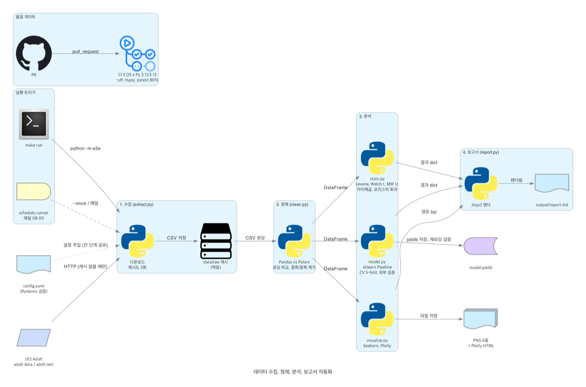
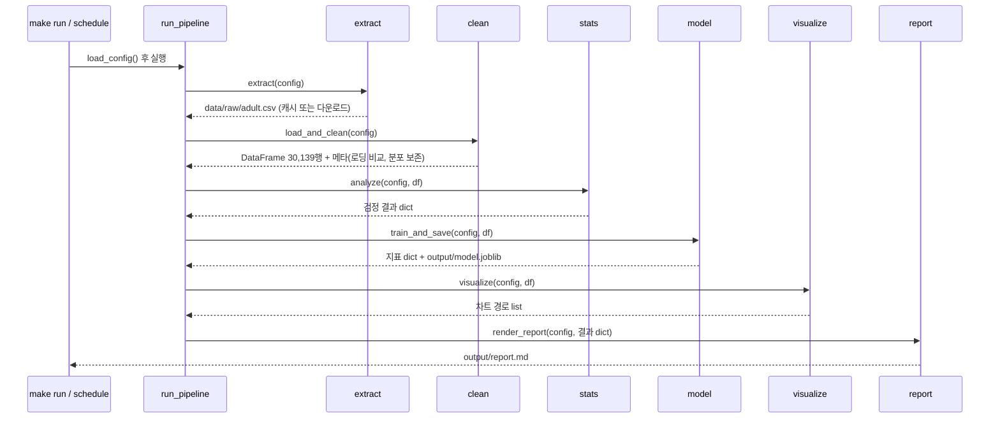

# Architecture

그림 생성 코드: [`docs/diagrams/architecture.py`](../diagrams/architecture.py) (`diagrams` + graphviz)

## 구성 요소

| 단계 | 모듈 | 하는 일 | 사용 도구 |
|---|---|---|---|
| 설정 | `config.py` | `config.yaml` 을 읽어 `AppConfig` 로 검증. 모든 단계는 이 객체 하나만 주입받음 | PyYAML, Pydantic v2 |
| 수집 | `extract.py` | 학습 원천(adult.data)과 외부 홀드아웃(adult.test) 다운로드. 캐시가 있으면 생략, 실패 시 3회 재시도하고 불완전 파일 삭제 | urllib |
| 정제 | `clean.py` | Pandas, Polars 로딩 비교(시간, 행수, 결측 일치), 중복과 결측 행 제거, 정제 전후 분포 보존 검증 | Pandas, Polars |
| 검정 | `stats.py` | 기술통계(분위수 포함), 상관, Levene, Welch t + CI, Mann-Whitney U, Cohen's d, 초과근무 카이제곱, 교란 통제 로지스틱 회귀, 보조가설(연령) | SciPy, statsmodels |
| 모델 | `model.py` | 전처리 + 분류기를 하나의 Pipeline 으로. LogReg, LogReg(balanced), RandomForest 비교, 5-fold, 외부 검증, 오즈비, joblib 저장 후 재로딩 검증 | scikit-learn, joblib |
| 시각화 | `visualize.py` | 박스플롯 2종, 밀도 히스토그램, 표본수 막대, 상관 히트맵, Q-Q 플롯, Plotly HTML | Matplotlib(Agg), Seaborn, Plotly |
| 보고서 | `report.py` | 단계별 결과 dict 를 Jinja2 템플릿에 주입해 `output/report.md` 렌더 | Jinja2 |
| 조립 | `pipeline.py` | 위 단계를 순서대로 호출하고 결과를 모음. 자체 로직 없음 | |

## 데이터 흐름

## 산출물

| 경로 | 내용 | 커밋 여부 |
|---|---|---|
| `data/raw/adult.csv`, `adult_test.csv` | 원천 캐시 | 안 함 (gitignore) |
| `output/report.md` | 최종 분석 보고서 | 안 함 (실행할 때마다 재생성) |
| `output/figures/*.png`, `*.html` | 차트 7종 | 안 함 |
| `output/model.joblib` | 저장 모델 | 안 함 |
| `docs/images/*.png` | README 용 캡처 (2026-11-05 실행본) | 함 |

## 실행 방식

| 방식 | 명령 | 특징 |
|---|---|---|
| 수동 | `make run` (`python -m e2e`) | 로그에 단계별 검증값 출력 |
| 스케줄 | `python scripts/schedule_runner.py` | 매일 08:00 실행. 잡 내부 예외는 로그만 남기고 루프 유지 |
| 시연 | `make schedule` (`--once`) | 즉시 1회. 실패 시 종료 코드 1 |
| CI | GitHub Actions | push(main), pull_request 마다 ubuntu, macos, windows x Python 3.11, 3.13 에서 ruff, mypy, pytest(커버리지 80% 게이트). 집계 잡 `quality-check` 가 브랜치 보호 대상, 결과를 PR 댓글로 갱신 |

## 설계 원칙

- **선언적 설정**: 데이터 URL, 컬럼, 타깃, 가설 변수, 유의수준, 분할 비율이 전부 `config.yaml` 에 있다. 테스트는 가짜 설정을 주입해 합성 데이터로 돈다
- **단계 분리**: 실패 지점이 곧 책임 모듈. 각 단계에 pytest 가 붙어 있다
- **자기 검증**: 각 단계가 결과와 함께 검증값(행수 일치, 분포 보존, 재로딩 일치, 방향 일치)을 반환하고 로그와 보고서에 남긴다
- **멱등성**: 원천 캐시, 산출물 덮어쓰기, seed 42 고정. 스케줄 재실행이 안전하다
- **보고서 자동 생성**: 수치를 사람이 옮기지 않는다. 소스 주석에도 실측값을 쓰지 않는다

## 배포

서버 배포는 하지 않습니다. 산출물은 로컬 `output/` 에 생성되고, 저장된 `model.joblib` 은 같은 Pipeline 구조라 다른 스크립트에서 `joblib.load` 후 바로 `predict` 할 수 있습니다.
