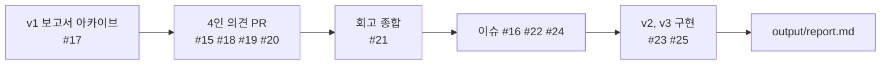

# Schedule

모든 작업은 2026-08-07 하루(KST 16:01 ~ 19:45) 안에 이슈 11개, PR 19개로 진행했습니다. 시각은 GitHub 이슈, PR 의 생성과 머지 시각 기준입니다.

## 타임라인

```mermaid
gantt
    title 2026-08-07 (KST)
    dateFormat HH:mm
    axisFormat %H:%M
    section 뼈대
    #1 config 파이프라인, 품질 게이트, CI   :done, 16:01, 21m
    section 병렬 확장
    #3 로딩 비교, 정제                      :done, 16:22, 16m
    #4 시각화                               :done, 16:22, 16m
    #5 통계, 모델 비교                      :done, 16:22, 16m
    #6 보고서 템플릿                        :done, 16:22, 22m
    section 버그
    #11 Polars 빈 줄                        :crit, done, 16:58, 5m
    section 회고
    의견 공간, v1 아카이브, 4인 의견        :done, 17:05, 64m
    회고 종합                               :done, 18:14, 3m
    section 개선
    #16 #22 분석 v2                         :done, 17:38, 51m
    #24 분석 v3                             :done, 18:28, 10m
    #26 문서 체계                           :done, 18:48, 3m
    #28 예외처리, 폴백                      :done, 19:36, 9m
```

| 이슈 | 생성 | 닫힘 | PR | 내용 |
|---|---|---|---|---|
| #1 | 16:01 | 16:22 | #2 | config 기반 파이프라인, 품질 게이트, CI |
| #3 | 16:22 | 16:38 | #7 | Pandas vs Polars 로딩 비교, 정제 근거 |
| #4 | 16:22 | 16:38 | #8 | 밀도 히스토그램, 상관 히트맵, Plotly |
| #5 | 16:22 | 16:38 | #9 | Levene, Mann-Whitney, 상관, 보조가설, 모델 비교 |
| #6 | 16:22 | 16:44 | #10 | 보고서 템플릿 통합 렌더 |
| #11 | 16:58 | 17:02 | #12, #13 | Polars 빈 줄 버그 |
| | | | #14, #17 | 의견 공간, v1 보고서 아카이브 |
| | | | #15, #18, #19, #20 | 4인 개별 의견 |
| | | | #21 | 팀 회고 종합 |
| #16 | 17:38 | 18:29 | #23 | 분석 v2: 비율 검정, CI, 외부 검증, 5-fold, 오즈비 |
| #22 | 18:18 | 18:29 | #23 | 회고 반영: 시각화 보강, 방어 코드, 주석 위생 |
| #24 | 18:28 | 18:38 | #25 | 분석 v3: 분포 보존, class_weight, 교란 통제 |
| | | | #26 | README 문서 체계 |
| #27, #28 | 19:34, 19:36 | 19:53, 19:45 | #29 | 분위수 출력, 예외처리, 다운로드 폴백 |

## 일을 쪼갠 방식

1. **뼈대 먼저**: config, Pydantic, 단계별 빈 모듈, Makefile, CI 를 첫 PR 에 넣었습니다. 이후 모든 작업이 같은 품질 게이트를 통과하게 하기 위해서입니다
2. **파일 단위 병렬**: 로딩(#3), 시각화(#4), 통계와 모델(#5)은 서로 다른 모듈만 건드리므로 같은 시각에 이슈를 열고 브랜치를 나눠 진행했습니다. 충돌은 없었습니다
3. **버그는 즉시 이슈로**: 실데이터 로그에서 `행수 일치=False` 를 보고 #11 을 열어 4분 만에 닫았습니다
4. **회고를 백로그로 끝내지 않기**: v1 보고서를 아카이브하고, 4명의 의견을 PR 로 받아, 회고 종합에서 중복 제거와 우선순위를 정한 뒤, 그대로 이슈 #16, #22, #24 로 바꿔 구현했습니다

## 브랜치 전략

| 규칙 | 내용 |
|---|---|
| 브랜치 이름 | `feature/#이슈번호-설명`, 문서는 `docs/설명` |
| 머지 조건 | CI 통과 (3 OS x 2 Python 매트릭스의 집계 잡 `quality-check`) |
| main | 직접 푸시 금지 (브랜치 보호) |
| 로컬 | `make hooks` 로 pre-commit 설치, 커밋 전 ruff, format 검사 |
| 템플릿 | `.github/ISSUE_TEMPLATE/task.md`, `.github/PULL_REQUEST_TEMPLATE.md` |
| 연결 | PR 본문 `closes #번호` 로 이슈 자동 종료 |
